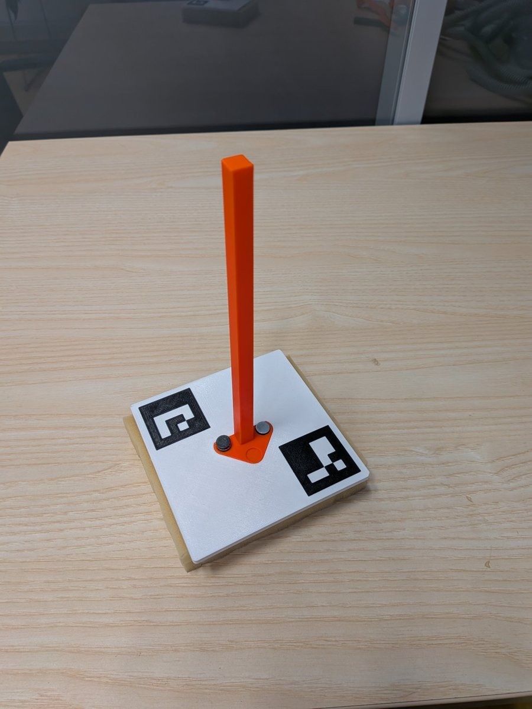
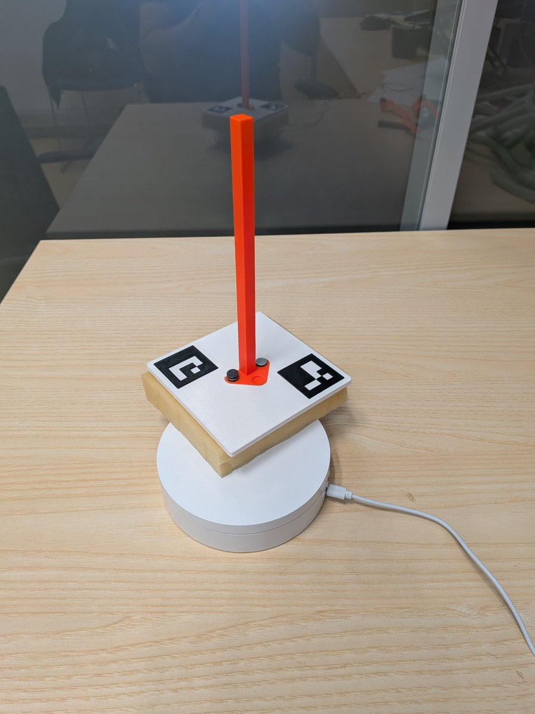
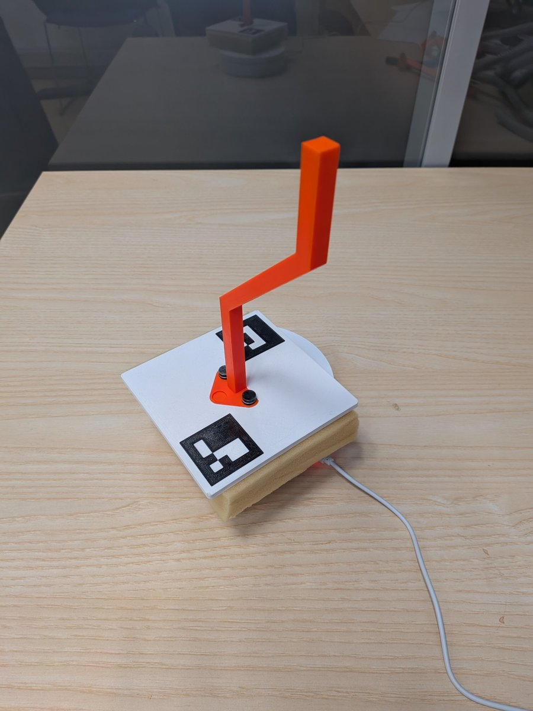
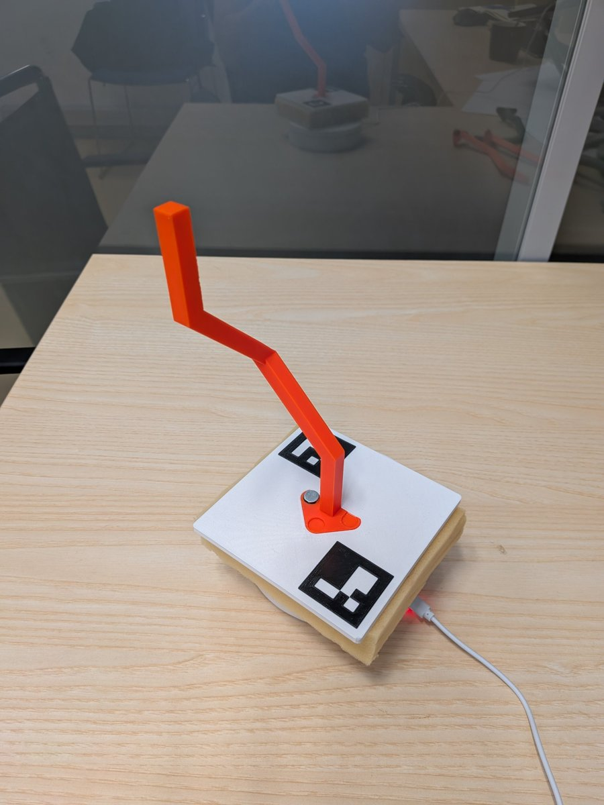
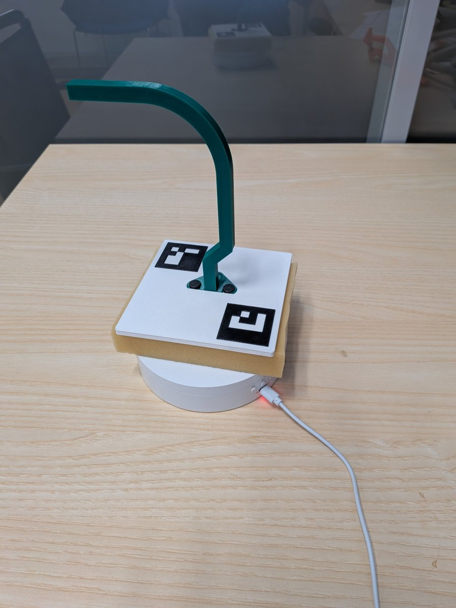

# CRS93 robotic semester project

Semester project from robotics: guide a 6DoF CRS93 robotic arm with a hoop through five project variants (A1, A2, B, C, D) without touching the rod. Hardware CAD source models are labeled A-E; A1 and A2 use the same A rod.

## Problem specification

Specification of rods can be found in this [repository](https://github.com/pilcsimo/ROB1-2025-hw). We start with the straight A rod (project variants A1 and A2), then continue through B, C and D.

Square plate (125 x 125 mm) with the rod is placed anywhere on the rotary table. Plate is marked with two ArUco marks placed on its opposite corners. Rod is mounted in the center of the plate, so its pose is fixed relative to the ArUco marks.

Rod has 10 x 10 mm cross-section and hoop has inner diameter 60 mm, which gives us around 23 mm of clearance. The hoop has to go through the whole rod from its free end and stop 4 cm above the plate. Hoop axis has to follow the rod direction, rotation of the hoop around the rod is free, we choose the handle to point towards the robot base.

We assume the table rotates with constant but unknown speed. Angular velocity is the same for the whole table, but since the plate can be anywhere, the center of rotation is unknown and the linear speed of the rod depends on its distance from the center. We expect rather faster rotation.

Camera gives 1920 x 1200 images at 10 fps (23 MB/s).

<table>
  <tr>
    <td></td>
    <td></td>
    <td></td>
    <td></td>
    <td></td>
  </tr>
  <tr>
    <td align="center"><b>A1</b></td>
    <td align="center"><b>A2</b></td>
    <td align="center"><b>B</b></td>
    <td align="center"><b>C</b></td>
    <td align="center"><b>D</b></td>
  </tr>
</table>

## High level architecture of possible solution

1. **Calibration.** Robot moves the hoop to at least 4 positions just above the plate, we detect hoop center in the image and compute homography from image to robot base frame. Plate height is known, so with the rod model we get the full 3D pose of the rod.
2. **Table motion estimation.** Before the robot moves, we observe the ArUco marks and estimate center of rotation, angular velocity (its sign gives direction) and phase.
3. **Trajectory.** From the rod model we compute its centerline from the free end to 4 cm above the plate, hoop axis follows the rod direction.
4. **Tracking.** Robot follows the trajectory in short `move_to_q` steps towards the rod pose predicted for the end of each step.
5. **Occlusion.** When the arm shadows the ArUco marks, we rely on the prediction. Whenever at least one mark is visible, we refine the estimate.

- Code requirements are in `AGENTS.md`.
- How to run the application is in `MANUAL.md`.

## Testing

- Offline simulation with the rod model and `fk`/`ik` from `ctu_crs`, checking that the rod stays inside the hoop.
- Lab testing about once a week.

### Setup

```sh
uv sync
uv run pre-commit install
```

### Commands

- `make` runs all checks (`make -k` continues after a failure).
- `make format`, `make lint`, `make typecheck`, `make test` run a single check.

All checks also run automatically before every commit and the commit is rejected if any of them fails. Do not bypass it with `--no-verify`.

## Open questions

- How fast does the table actually rotate?
- How long does one short `move_to_q` take?
- What does the controller do when `move_to_q` is sent while the robot is still moving?
## Implemented geometry (offline only)

- `hoop_guide.rods` implements the centerlines for project variants A1, A2,
  B, C and D. Models are assembled from `LineSegment` and `ArcSegment`, both
  implementing the small `RodSegment` interface. `RodModel.sample(step)`
  produces points and unit tangents in the **local plate frame**, in order
  from the free end toward the plate.
- Geometry was checked against `ROB1-2025-hw-main/puzzles/A.step` through
  `D.step` and the corresponding pages 1-4 of `drawings/puzzles.pdf`.
  The hardware repository also contains puzzle E, which is not a separate
  variant in our current A1/A2/B/C/D menu.
- CAD reference waypoints (x, y, z) below are in **millimeters**, in the
  source puzzle CAD coordinate axes. The program stores them in meters.

| Variant | CAD centerline from free end toward base (mm) |
|---|---|
| A1 / A2 | (0,0,200) → (0,0,40) |
| B | (70,0,200) → (70,0,150) → (0,0,80) → (0,0,40) |
| C | (-50,-50,200) → (-50,-50,150) → (-50,0,100) → (0,0,50) → (0,0,40) |
| D | (85,0,155) → (35,0,155) → **R50 circular quarter arc**, center (35,0,105), to (-15,0,105) → (-15,0,45) → (-10,0,40) |

- `rod_centerline(puzzle, plate, plate_height, step)` transforms the sampled
  centerline and tangents to the **robot frame** for a given horizontal-plate
  pose, using `plate_to_robot`. The external motion estimation must supply the
  predicted pose of a rotating plate at the relevant time.
- `hoop_guide.geometry.hoop_cad_to_center()` provides the center of the ring
  hole in the **Hoop.step CAD frame**: (0, -135, -3.3) mm. The center-frame
  axes follow the Hoop.step axes; its local Z is normal to the ring plane.
- `AdapterMount` combines two explicitly supplied, calibrated rigid poses:
  flange → adapter and adapter → Hoop.step CAD frame. It then includes the
  known ring-center offset. `flange_for_hoop()` computes the pose to supply
  to IK. **No mounting calibration or actual robot tool frame is assumed.**
- Selecting any variant A1/A2/B/C/D in the menu prints the number of
  sampled points. It is a text-only preview and sends no movement commands.
- To check geometry and mounting mathematics independently:

```sh
uv run pytest tests/unit/test_rods.py tests/unit/test_geometry.py --no-cov -v
```

**Before physical execution:** verify the origin and yaw of each mounted
puzzle relative to the upper plate surface, the measured plate height,
`ctu_crs` FK/IK tool frame, the assembly and calibration of the adapter,
collision clearance (especially at sharp corners and the D bend), safe
approach/retraction, and joint limits. `STOP_HEIGHT = 0.040 m` is a nominal
**hoop center height**, not proof of passing below the 40 mm finish criterion.
The code contains **no collision avoidance, orientation planner, IK motion
planning, tracking or real-robot movement for puzzle modes** yet.

## Offline hoop-orientation and adapter pose preview (update 3)

The planning additions **do not** command the robot, compute IK or validate
collisions. They convert the existing puzzle centerline into nominal complete
**hoop-center poses** and, separately, into nominal **flange poses**:

- `hoop_guide.planning.hoop_pose_path(...)`: creates N homogeneous matrices
  `R_T_H` (each 4 x 4), in the robot frame. The hoop frame `H` has origin at
  the center of the hole, local **+Z_H opposite the path tangent**, and local
  **+Y_H pointing from ring center toward the holder**. The latter is selected
  by projecting the horizontal direction toward the robot base into the hoop
  plane. It is a **heuristic**, not a guaranteed safe mounting orientation.
- The result stores `sharp_corner_indices` where the rod tangent jumps, and
  `fallback_heading_indices` where the direction toward the base does not
  uniquely determine holder orientation. Such locations need manual handling
  and collision checking. `large_rotation_step_indices` also flags overly
  large adjacent frame rotations (offline threshold 30 degrees).
  The actual ring, holder and adapter have thickness;
  following the rod centerline at sharp corners is **not necessarily possible**.
- `hoop_guide.tool_setup.initial_offline_tool_estimate()` produces an
  **UNVERIFIED, OFFLINE-ONLY** `ToolCalibration`:
  - Flange -> adapter: identity by choice of adapter frame at flange
    (coordinate convention, not a physical measurement).
  - Adapter -> Hoop.step CAD frame: identity **ARBITRARY INITIAL GUESS**.
    This is NOT a validated physical mounting. Replace with measured assembly.
  - Hoop.step CAD -> ring center: **CAD-derived** translation of
    `(0, -0.135, -0.0033)` meters (ring opening in CAD XY plane).
- `path.flange_poses(tool_calibration)` refuses unverified mounting and known
  sharp corners / ambiguous holder headings by default. Use
  `path.flange_poses(tool_calibration, preview_only=True)` **strictly for offline
  preview**. Even with a verified tool calibration and no flags, the returned
  poses are NOT collision checked or executable robot motion.

Try this without connecting to CRS93:

```sh
uv run python -m examples.preview_tool_path A1
uv run python -m examples.preview_tool_path B --plate-x 0.45 --plate-y 0.10 --plate-height 0.08 --step 0.01
uv run pytest tests/unit/test_planning.py --no-cov -v
uv run pytest
```

The example plate pose/height `(0.45, 0.10, 0.08)` m and estimated mounting
matrices are **BEST GUESS / DEMONSTRATION VALUES, NOT MEASURED OR FINAL**.
The physical plate height and plate-to-robot frame need calibration; verify
which `ctu_crs.fk/ik` output frame the adapter is bolted to, and measure the
actual flange -> adapter -> hoop-CAD mounting including the yaw/roll/pitch.
Verify the origin/orientation of the rod CAD models in the mounted plate frame,
terminal 40 mm condition, ring/holder clearance at corners and bends, safe
approach and retreat, IK continuity, joint limits and collisions before any
actual motion. The path is for a **fixed plate pose**, not a time-parametrized
prediction of a rotating plate.

### Offline corner passage and clearance screening (fourth development patch)

For a **nominal geometry-only** preview of the ring, its integral handle, the
rod and the plate top, use:

```shell
uv run python -m examples.preview_clearance_path A1
uv run python -m examples.preview_clearance_path B
uv run python -m examples.preview_clearance_path C
uv run python -m examples.preview_clearance_path D --step 0.003
```

The new `hoop_guide.clearance.screen_hoop_path()` function uses the previously
implemented `RodModel` and adds:

- smooth cubic-Hermite **center reference** at non-tangent rod junctions;
- a discrete/global search for a continuous hoop handle heading about the rod
  tangent; that heading may depart from the original preference toward the
  robot base to avoid a modeled collision;
- conservative capsule envelopes for the square-section rod, the annular hoop
  **and its integrated handle** (the latter is part of `Hoop.step`), and the
  horizontal infinite plate-top plane;
- adaptive interpolation checks between adjacent poses, not only individual
  sample poses;
- explicit `unresolved_intervals` and `restricted_corner_indices` diagnostics.

The geometric surrogate is based on `Hoop.step`, the supplied drawings and the
CAD-derived rod centerlines. In the source code, constants for the envelope and
2 mm provisional clearance target are documented. A STEP-mesh *vertex*
inspection informed the envelope radii, but is **not an exact solid-to-solid
proof**; mounting tolerances, CAD surface coverage, actual plate position and
hardware effects still require verification. The portions of rod below the
nominal 40 mm stop are extended from the last segment as an explicitly marked
**best-guess approximation**, especially for puzzle D.

**Do not confuse `geometric_screen_passed=True` with safe robot execution.**
This only means a continuous candidate passed the conservative *approximate*
hoop/handle-vs-rod/plate screen for the specific example plate pose. No
full-geometry CRS adapter collision check, robot collision check, IK,
velocity/timing limits, turntable motion or hardware commands are present.
The `flange_preview()` method remains an offline diagnostic and deliberately
accepts an unverified tool transform **only** as an explicitly labeled preview.

The nominal 40 mm hoop-center endpoint is not independently checked to meet
any strict below-40-mm scoring requirement. Verify the exact scoring datum
before changing it. For real hardware, measure and validate the mounted puzzle,
actual flange/TCP conventions and the complete adapter-assembly transform.
