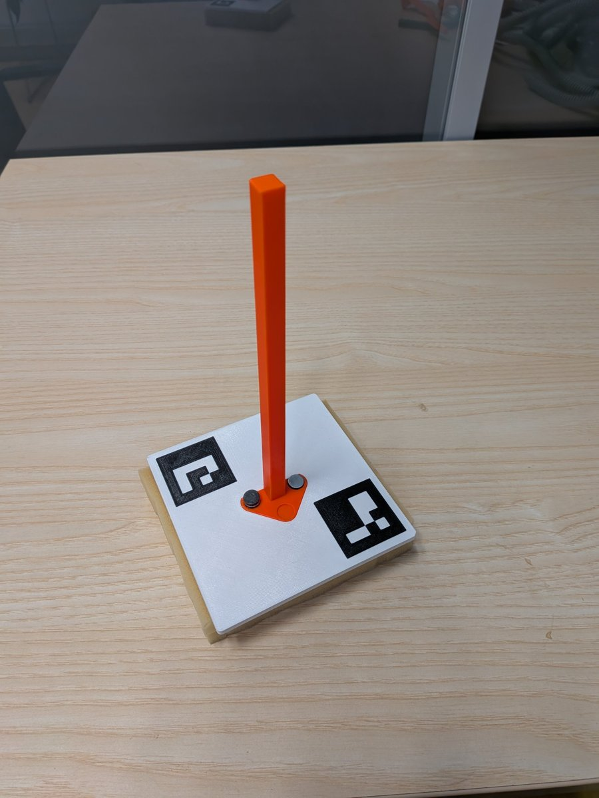
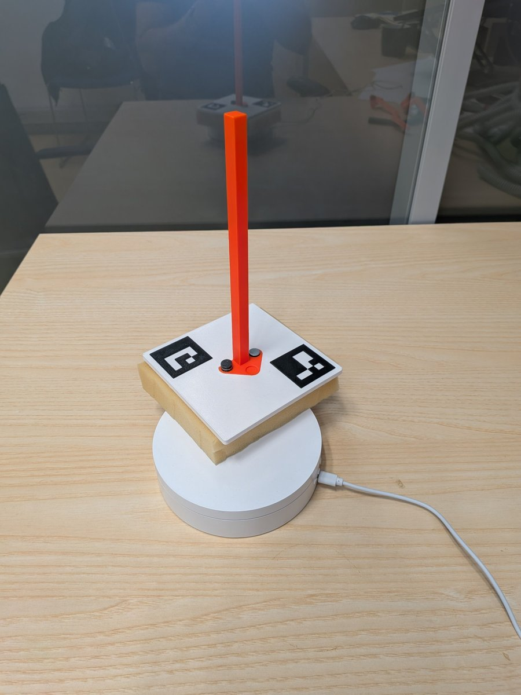
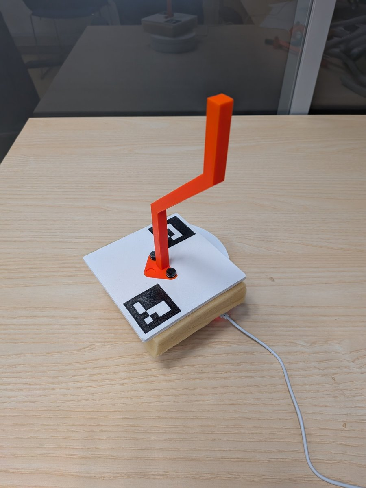
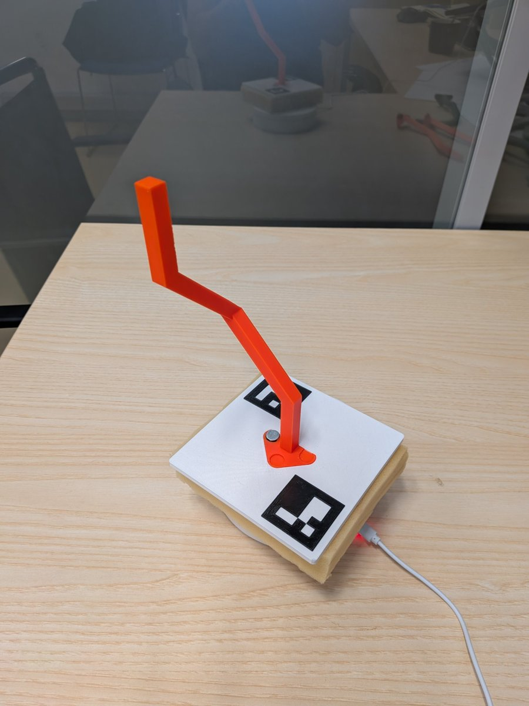
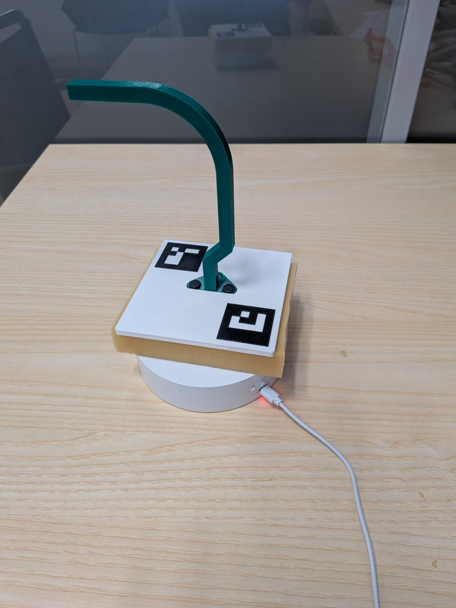

# CRS93 robotic semester project

Semester project from robotics, our goal is to write software that is going to guide 6DoF CRS93 robotic arm with a hoop through 5 different rotating bent rods (puzzles A-E) without touching the rod.

## Problem specification

Specification of rods can be found in this [repository](https://github.com/pilcsimo/ROB1-2025-hw). We are going to start from the easiest case (A) and end up with the hardest one (E).

Square plate (125 x 125 mm) with the rod is placed anywhere on the rotary table. Plate is marked with two ArUco marks placed on its opposite corners. Rod is mounted in the center of the plate, so its pose is fixed relative to the ArUco marks.

Rod has 10 x 10 mm cross-section and hoop has inner diameter 60 mm, which gives us around 23 mm of clearance. The hoop has to go through the whole rod from its free end and stop 4 cm above the plate. Hoop axis has to follow the rod direction, rotation of the hoop around the rod is free, we choose the handle to point towards the robot base.

We assume the table rotates with constant but unknown speed. Angular velocity is the same for the whole table, but since the plate can be anywhere, the center of rotation is unknown and the linear speed of the rod depends on its distance from the center. We expect rather faster rotation.

<table>
  <tr>
    <td></td>
    <td></td>
    <td></td>
    <td></td>
    <td></td>
  </tr>
  <tr>
    <td align="center"><b>A1</b></td>
    <td align="center"><b>A2</b></td>
    <td align="center"><b>B</b></td>
    <td align="center"><b>C</b></td>
    <td align="center"><b>D</b></td>
  </tr>
</table>

## High level architecture of possible solution

1. **Calibration.** Robot moves the hoop to at least 4 positions just above the plate, we detect hoop center in the image and compute homography from image to robot base frame. Plate height is known, so with the rod model we get the full 3D pose of the rod.
2. **Table motion estimation.** Before the robot moves, we observe the ArUco marks and estimate center of rotation, angular velocity (its sign gives direction) and phase.
3. **Trajectory.** From the rod model we compute its centerline from the free end to 4 cm above the plate, hoop axis follows the rod direction.
4. **Tracking.** Robot follows the trajectory in short `move_to_q` steps towards the rod pose predicted for the end of each step.
5. **Occlusion.** When the arm shadows the ArUco marks, we rely on the prediction. Whenever at least one mark is visible, we refine the estimate.

- Code requirements are in `AGENTS.md`.

## Testing

- Offline simulation with the rod model and `fk`/`ik` from `ctu_crs`, checking that the rod stays inside the hoop.
- Lab testing about once a week.

### Setup

```sh
uv sync
uv run pre-commit install
```

### Commands

- `make` runs all checks (`make -k` continues after a failure).
- `make format`, `make lint`, `make typecheck`, `make test` run a single check.

All checks also run automatically before every commit and the commit is rejected if any of them fails. Do not bypass it with `--no-verify`.

## Open questions

- How fast does the table actually rotate?
- How long does one short `move_to_q` take?
- What does the controller do when `move_to_q` is sent while the robot is still moving?